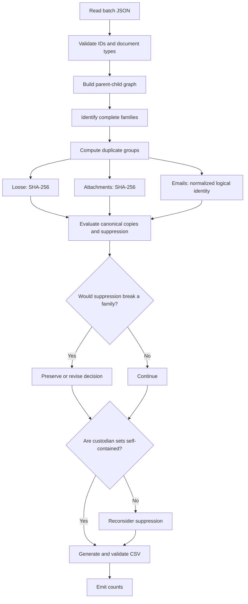
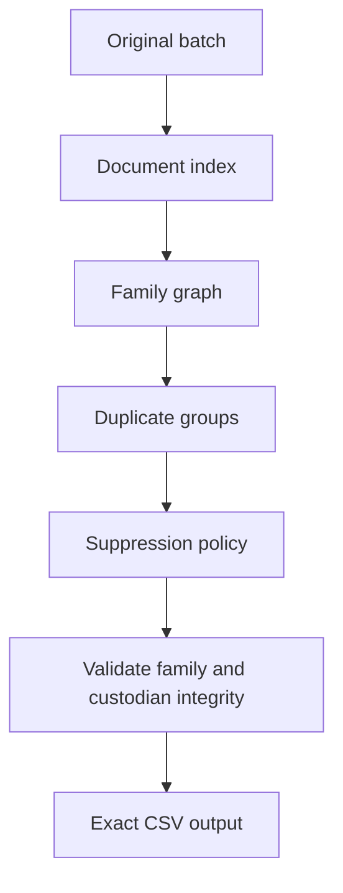
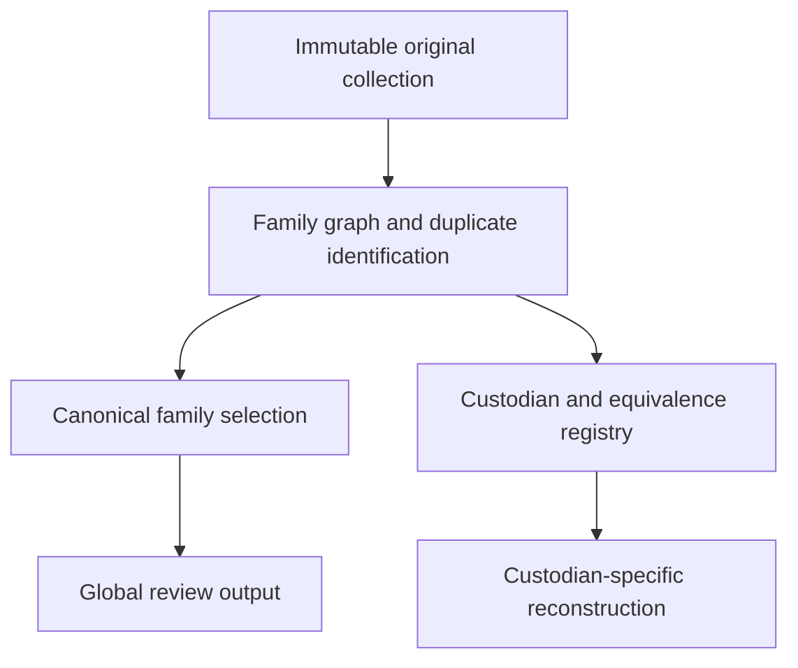
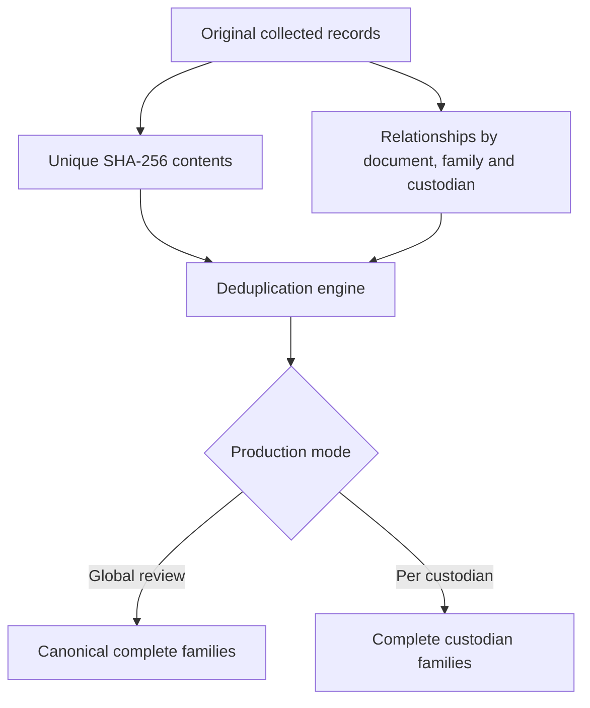

# eDiscovery Deduplication — Conversation in English

**Purpose:** English-language record of the discussion about the Senior Engineer technical exercise.

**Transcript note:** This is an **edited English translation**, not a byte-for-byte or certified transcript. The original discussion took place mainly in Spanish. Long assistant explanations are condensed while retaining their substantive analysis, examples, design decisions, and warnings. The separately supplied `CODEX_EDISCOVERY_DEDUP_PROMPT.md` contains the full Codex implementation prompt. Do not represent this edited translation as an unmodified AI conversation transcript when submitting the exercise; provide the original chat export as well if verbatim transcripts are required.

---

## 1. Translate README.md

**User:** Translate it into Spanish. *(Attached `README.md`.)*

**Assistant (English rendering of the response):**

### Senior Engineer Technical Exercise

Thank you for taking the time. The exercise should take **45–60 minutes**. Stop after 60 minutes even if unfinished. The workload deliberately exceeds the available time so the team can evaluate prioritization.

You have joined the ingest platform team. Its tool deduplicates collection batches and writes CSV load files for a review platform. The functional specification is in `SPEC.md`; implementation is under `src/`.

**Ticket INGEST-4471: Emails arrive for review without their attachments.** Reviewers in the Halvorsen matter report that emails which had attachments in the original mailboxes reach the review platform without them. The issue appeared after deduplication. Reproduction data: `data/batch-sample.json`; current output: `data/current-tool-output.csv`.

The specification also requires cross-mailbox email deduplication (§3.3), which has not yet been implemented.

Requirements: diagnose and fix missing attachments; implement cross-mailbox deduplication; produce the exact load-file format; add tests; fill in `DECISIONS.md` with ambiguities, decisions, rationale and unfinished work; include AI-assistant conversation transcripts. Finishing everything is not required, but the codebase must remain ready for a teammate to continue.

AI use is permitted. Reviewers will assess how AI was directed, what was verified, and where its output was challenged. The starter is C#/.NET 8, though another language is permitted if the CLI and CSV contracts are preserved and the decision documented. Hidden batches will be tested. Ambiguities may be raised with the interviewer or resolved with an explicitly documented assumption.

Commands:

```bash
cd src/DedupTool
dotnet run -- ../../data/batch-sample.json out.csv
cd ../..
dotnet test
```

Deliver a ZIP or repository link containing code, tests, `DECISIONS.md`, and AI transcripts. A 25-minute follow-up will review design decisions, execute the tool against new data, and introduce a changed requirement.

**Assistant's interpretation:** The exercise evaluates more than coding: debugging, understanding the spec, time management, maintaining evidence integrity, testing, and communicating decisions. Review `SPEC.md` and `src/` before selecting the implementation.

---

## 2. Translate SPEC.md

**User:** Now this document. *(Attached `SPEC.md`.)*

**Assistant (English rendering of the response):**

### Batch Deduplication Tool — Functional Specification (v1.3)

**Purpose:** Read a collection batch and produce a load file so reviewers do not see content twice and each reviewed document retains its full context.

**Input:** JSON object with `batchId` and `documents`. Each document has a unique `docId`, `custodian`, `docType` (`email`, `attachment`, `loose`), optional `parentId`, `fileName`, `sha256`, and `sizeBytes`. Email records also have `sentDate`, `from`, `to`, `subject`, and plain-text `body`. Attachments may contain nested attachments using `parentId` chains.

**Deduplication:**

- §3.1: Loose files with identical SHA-256 are duplicates.
- §3.2: Attachments with identical SHA-256 are duplicates.
- §3.3: Copies of a single email from different mailboxes are duplicates even when raw hashes differ due to headers, encoding, or line endings.
- §3.4: Deduplication is performed across the whole batch.
- §3.5: Emails and their attachments form families. Output families must be complete.
- §3.6: Suppressed duplicates must be omitted from the load file.

**Custodian requirement (§4):** Each custodian's production set must be complete and self-contained in case that custodian is later severed from the matter.

**Load file (§5):** CSV columns, in exactly this order:

```text
DocID,FamilyID,ParentID,Custodian,DocType,FileName,SentDate,Hash
```

`FamilyID` is the top-level family document ID (a loose file uses its own ID). `ParentID` is the original parent ID or empty. Attachments inherit the top-level email's `SentDate` in exact UTC format `YYYY-MM-DDTHH:MM:SSZ`; loose files have an empty date. Row order is not significant.

**Operations (§6):** Input order must not affect output; batches can approach two million documents; the tool prints a one-line summary with counts in, out, suppressed.

**Assistant's added technical observations:** Three areas require explicit design choices in `DECISIONS.md`: (1) how logical email equivalence is computed without a specified algorithm; (2) global SHA-based attachment deduplication versus the requirement to preserve intact families; and (3) global suppression versus independently producible custodian sets. These observations are analysis, not additional textual requirements from `SPEC.md`.

---

## 3. Process diagram, potential data loss, contradictory rules

**User:** Generate a process diagram and identify possible causes of data being removed when it should not be, or contradictory rules.

**Assistant:**



The main suspected failure points were:

1. **Attachments deduplicated before families are preserved.** If two attachments share a hash but belong to different emails, retaining one occurrence can leave the surviving email without its attachment. This was a high-priority hypothesis, not a confirmed source-code diagnosis.
2. **Parent suppressed while descendants remain.** Children can become orphaned or be silently dropped by a later cleanup/filter.
3. **Over-aggressive email normalization.** Two distinct messages can be incorrectly merged when the comparison ignores meaningful differences.
4. **Global attachment deduplication without relationship context.** The same PDF may need to appear within multiple email families.
5. **Canonical choice depends on input order.** A 'first seen wins' strategy violates determinism.
6. **Nested attachment graph not supported.** Family roots, dates, and descendants can be computed incorrectly.
7. **Custodian provenance lost.** A global winner can leave another custodian without a self-contained production.
8. **Incorrect timezone/date handling** and **recipient normalization** can create false matches or missed matches.
9. **CSV writer incorrectly filters descendants** even after a correct in-memory deduplication decision.

Key specification tensions:

- §3.2 versus §3.5: identical attachment bytes versus complete families.
- §3.4 versus §4: global deduplication versus self-contained custodian productions.
- §3.6 versus §3.5: suppressed rows omitted versus family completeness.
- §3.3 leaves email-equivalence rules unspecified.

Recommended priorities: protect family integrity, make the precedence policy explicit, implement conservative cross-mailbox matching, and enforce deterministic output. Build families first, detect duplication, then separately decide whether suppression is safe.

---

## 4. Inspect and structure the sample batch

**User:** Let's structure the file to see what is missing or what we should add. *(Attached `batch-sample.json`.)*

**Assistant:**

The batch contains **16 documents**, with **6 emails, 6 attachments, and 4 loose files**. Each of two custodians has 8 documents.

| Custodian | Emails | Attachments | Loose | Total |
|---|---:|---:|---:|---:|
| `jsmith` | 3 | 3 | 2 | 8 |
| `mlee` | 3 | 3 | 2 | 8 |
| **Total** | **6** | **6** | **4** | **16** |

Family hierarchy:

```text
jsmith
  DOC-000001  Q3 budget review.eml
    DOC-000002  Q3-budget.xlsx
    DOC-000003  vendor-report.pdf
  DOC-000004  FW vendor report.eml
    DOC-000005  vendor-report.pdf
  DOC-000006  Lunch.eml
  DOC-000007  notes.txt
  DOC-000008  policy.docx

mlee
  DOC-000009  Q3 budget review.eml
    DOC-000010  Q3-budget.xlsx
    DOC-000011  vendor-report.pdf
  DOC-000012  Re Q3 budget review.eml
  DOC-000013  policy.docx
  DOC-000014  mlee-notes.txt
  DOC-000015  Team offsite.eml
    DOC-000016  agenda.docx
```

Duplicate/equivalence groups identified:

| Documents | Meaning | Risk |
|---|---|---|
| 001 / 009 | Same logical email; different raw SHA and custodians | High |
| 002 / 010 | Same Excel content in separate families | High |
| 003 / 005 / 011 | Same PDF used in three different email relationships | Critical |
| 008 / 013 | Same loose file across custodians | High |

`DOC-000003`, `DOC-000005`, and `DOC-000011` exemplify why content identity is not the same as a document's role in a family.

**Potential internal metadata** (not changes to the required input JSON): `familyId`, `logicalEmailKey`, `duplicateGroupId`, `canonicalDocId`, `dedupDecision`, and `decisionReason`. Keep `docId`, `custodian`, `parentId` and `sha256` as supplied.

Suggested architecture:



Illustrative policies for the 16-row sample:

- Naive global hash suppression: around 12 retained rows, but may break families and custodian sets.
- Protect families but suppress one repeated loose file: 15 retained rows, but one custodian loses its independent copy.
- Protect every family and custodian: 16 retained rows, but global duplicate suppression is not fully achieved.

These counts were **illustrative policy scenarios, not results from running the tool**.

Suggested tests: cross-mailbox equivalence, attachment reuse in several families, repeated loose files across custodians, equivalent UTC timestamps, nested attachments, and determinism under shuffled input.

The three major open decisions were: cross-custodian suppression policy, repeated attachments across families, and how strictly to normalize email identity.

---

## 5. What is best for eDiscovery?

**User:** In summary, based on what they ask, which approach is best for eDiscovery? The goal is not to lose data, but to reduce ingestion.

**Assistant:**

For a complete eDiscovery system, prefer **global family-level deduplication for review, an immutable original-evidence store, and a custodian/equivalence mapping**.

Separate three concerns:

1. Preserve collected originals and evidentiary provenance.
2. Suppress redundant *review presentations* at the family level.
3. Retain the ability to reconstruct complete production sets for each custodian.

Do not suppress an attachment solely because the same bytes exist in another, different email family. For example, the `vendor-report.pdf` in the forwarded email must remain accessible through that email.

Proposed end-to-end model:



The larger product architecture supports both global review deduplication and reconstructable individual custodian productions. However, **the exercise's one-CSV contract does not specify an auxiliary mapping or multiple publication modes**. An external index by itself cannot make the fixed CSV fully comply with both §3.4 and §4. A global 12-row output is conceivable for the small sample if a redundant family and loose copy are suppressed, but it would not independently satisfy each custodian's production requirement without additional mechanisms. The sample's reduction rate should not be extrapolated.

---

## 6. Best practical approach for the technical exercise

**User:** In summary, based on the requirements, what is the best course of action?

**Assistant:**

Prioritize:

1. Diagnose and fix the missing attachment issue by constructing families before suppression.
2. Add cross-mailbox email matching using conservative normalization of sender, recipients, UTC date, subject and body.
3. Identify SHA-256 duplicates while preserving necessary attachment relationships.
4. Preserve complete custodian productions, documenting the exception to strict global suppression.
5. Emit precisely the required eight-column CSV with valid family and parent references.
6. Add automated tests for correctness, deduplication, custody, and input-order independence.
7. Record unresolved ambiguities and the reasons for decisions in `DECISIONS.md`.

The central architectural rule: **duplicate detection and duplicate suppression are not the same operation**. If a duplicate occurrence is necessary for family or custodian integrity, retain the relationship. Ask for clarification if possible, otherwise choose and document a conservative rule. Avoid changing the input or CSV schema; use internal indexes and relationships.

---

## 7. Intermediate table for attachments referenced by emails

**User:** Would it work if we had an intermediate table with document names and emails referenced those documents?

**Assistant:**

Yes; a relationship table is a strong approach. **Use SHA-256, not the filename, for content identity** because filenames are not unique identifiers for bytes.

Conceptual entities:

- **Documents / ContentIndex:** unique physical content keyed by hash.
- **Emails:** original or logical email identities.
- **DocumentRelations:** links between an email, its original attachment record, a family, and a custodian.

Example relations:

| EmailId | AttachmentDocId | Physical content |
|---|---|---|
| DOC-000001 | DOC-000002 | Q3-budget.xlsx |
| DOC-000001 | DOC-000003 | vendor-report.pdf |
| DOC-000004 | DOC-000005 | vendor-report.pdf |
| DOC-000009 | DOC-000010 | Q3-budget.xlsx |
| DOC-000009 | DOC-000011 | vendor-report.pdf |

Five attachment occurrences and their parent-child associations remain recorded, even though only two unique physical contents are needed. This enables complete family reconstruction per custodian.

For the coding exercise, use an **in-memory relation/index**, not a new database. An example internal record is:

```csharp
public record DocumentRelation(
    string ParentDocId,
    string AttachmentDocId,
    string ContentHash,
    string Custodian,
    string FamilyId
);
```

Pipeline: index records, group physical bytes, build parent-child graph, detect cross-mailbox email duplicates, evaluate safe suppression, reconstruct valid families, and write the mandated CSV.

**Important:** physically storing a file only once does **not** mean writing its attachment occurrence only once in the CSV. The latter has its own original `DocID`, `ParentID`, and `FamilyID`. The specification does not allow substituting the required CSV attachment rows with an external table reference.

---

## 8. Finally, how do we eliminate the contradiction?

**User:** Ultimately, how do we eliminate the contradiction?

**Assistant:**

Architecturally, **separate physical storage deduplication, global review deduplication, and per-custodian production**.



This gives reduced physical storage, reduced redundant review work, preserved parent-child relationships, and a way to recover each custodian's original family records.

**Contract distinction:** The architecture resolves the business requirements in an expanded eDiscovery system, **not automatically in this exercise's fixed single-CSV output**. The spec does not define auxiliary outputs, reconstruction, or two production modes. Therefore implement the indexes internally, keep the required output unchanged, and document that strict global suppression and independent custodian subsets cannot always be guaranteed simultaneously by the supplied contract. Request a precedence clarification; if no answer arrives, select and explicitly document a conservative family/custodian-preserving policy.

The central conclusion was: **change the data representation and production model in a full system, but do not claim the fixed exercise specification's contradiction is magically resolved**.

---

## 9. Request for a complete Codex implementation prompt

**User:** Give me the prompt to implement this in Codex, starting with analysis and ending with the proposed solution.

**Assistant:**

A master prompt was drafted for Codex to act as a senior C#/.NET engineer. It directed Codex to:

- Inspect `README.md`, `SPEC.md`, `DECISIONS.md`, sample data, existing output, source code, and tests before rewriting anything.
- Diagnose the actual source-code cause of lost attachments instead of assuming it.
- Distinguish original document IDs, physical content identity, family graphs, email logical identity, deduplication groups, and suppression decisions.
- Identify equivalence in sample IDs `001/009`, `002/010`, `003/005/011`, and `008/013` without hardcoding IDs.
- Document conflicts among §§3.2–3.6 and §4 and treat family/custodian preservation as a conservative provisional policy.
- Implement deterministic, conservative email matching with normalized addresses, UTC date and line endings.
- Build safe parent/child structures supporting nested attachments.
- Use exactly the required CLI and CSV format.
- Add regression, contract, determinism, invalid-parent, and performance-oriented tests.
- Update `DECISIONS.md` with actual root cause, architecture decisions, tradeoffs, remaining conflicts, unfinished work, and next steps.
- Avoid unnecessary infrastructure and state honestly what tests were executed.

**Related deliverable:** `CODEX_EDISCOVERY_DEDUP_PROMPT.md` is the full English prompt from the conversation; include that file alongside this translated discussion if needed.

---

## 10. Request to download the Codex prompt

**User:** Generate the prompt again so I can download it as an `.md` file.

**Assistant:** A downloadable Markdown file named `CODEX_EDISCOVERY_DEDUP_PROMPT.md` was provided. It contains analysis, design, implementation, CSV validation, tests, and documentation instructions. Codex could be instructed to read the file from the repository root and follow it.

---

## 11. Request to export this discussion in English

**User:** Can you download this conversation in English?

**Assistant:** This Markdown file was created as an English-language, edited translation of the technical exchange. It includes the discussion's progression, sample references, contradictory rules, proposed architecture, and final implementation direction. For an assessment that explicitly requires verbatim AI transcripts, also provide the unedited conversation export rather than replacing it with this translated/edited document.

---

## Final technical position

- Preserve all collected source evidence and all original document relationships.
- Represent binary duplicate identity independently of email/attachment occurrences.
- Compare cross-mailbox emails with a documented, conservative logical identity algorithm.
- Never silently sever a surviving email from any original attachment.
- Choose deterministic canonical records and record suppression decisions.
- Retain custodian provenance and document the unresolved single-CSV contract conflict.
- Keep the assignment within its scope: C#/.NET 8, original CLI, exactly eight CSV columns, regression tests, and `DECISIONS.md`.
